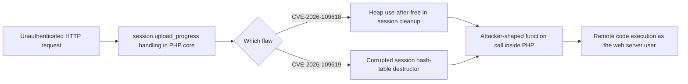
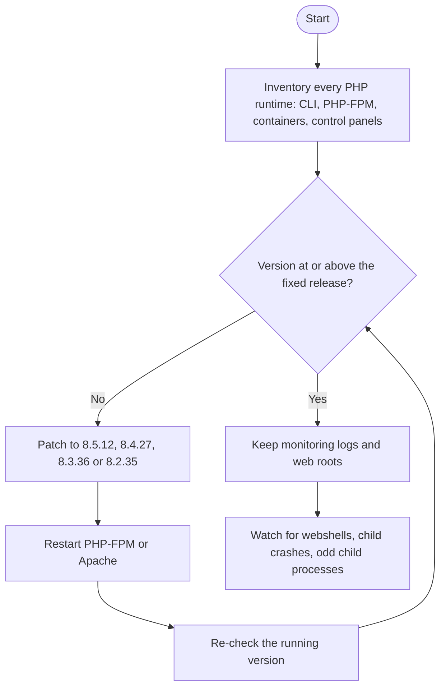

# php2shell: proof of concept and detection for CVE-2026-109618 and CVE-2026-109619

php2shell is a proof-of-concept and patch-check toolkit for the two critical PHP core vulnerabilities known as php2shell: CVE-2026-109618 and CVE-2026-109619.

It is written for defenders and authorized testers. Use it to find affected systems, confirm a patch took effect, and understand the exploit chain well enough to detect it in your own logs.

> **Authorized use only.** Run this only against systems you own or have written permission to test. See the [Disclaimer](#disclaimer).

Full write-up for defenders: [What CVE-2026-109618 and CVE-2026-109619 mean for your servers](https://cyberautomations.com/blog/php2shell-what-cve-2026-109618-and-cve-2026-109619-mean-for-your-serve?utm_source=github&utm_medium=readme&utm_campaign=php2shell-poc).

- CVE-2026-109618 ([GHSA-w8hw-w9fx-j79w](https://github.com/php/php-src/security/advisories/GHSA-w8hw-w9fx-j79w)): heap use-after-free in the `session.upload_progress` cleanup path.
- CVE-2026-109619 ([GHSA-6wmf-4rv5-p3rp](https://github.com/php/php-src/security/advisories/GHSA-6wmf-4rv5-p3rp)): corrupted session hash-table destructor leading to an arbitrary function call.

Vendor advisories and patches: [php.net security archive](https://www.php.net/archive/2026.php), patch commit [3584a98](https://github.com/php/php-src/commit/3584a98bda).

## What php2shell is

php2shell is the informal name for two PHP core vulnerabilities, CVE-2026-109618 and CVE-2026-109619. Both sit in the `session.upload_progress` machinery inside the PHP runtime, not in any application, so any PHP-powered site can be exposed. Both can lead to remote code execution as the web server user from an unauthenticated request.

This repository holds `php2shell.py`. Its main use is the read-only `check` mode for fingerprinting a server and confirming patch state. It also has a `syms` mode for local binary analysis and an `exploit` mode that, in this public build, only probes whether the use-after-free path is reachable. The code-execution step has been removed, so nothing here runs a command on a target. The modes are listed in the table below.



| Mode | What it does | Traffic |
|------|--------------|---------|
| `check` | Fingerprints PHP version, SAPI type, and `upload_progress` state from response headers | Plain GET requests |
| `check --multi-tech` | **NEW:** Multi-technology fingerprint (PHP, Node.js, Python, Java, Go, .NET, Ruby, Perl) with version detection, easter eggs, reveal paths, cookie markers, and benign upload_progress probe | GET + optional POST + reveal path requests |
| `exploit --vector uaf` | CVE-2026-109618: sends the use-after-free reachability trigger and reports whether the path responds. The forged-call code-execution step is removed from this public build | Crafted multipart POSTs |
| `exploit --vector pdetector` | CVE-2026-109619: stub only, prints calibration info and sends nothing | None |
| `syms` | Extracts `zval_ptr_dtor` and `zend_call_function` offsets and their delta from a `libphp.so` ELF | Local binary analysis only |

The `exploit` mode in this public build does not execute a command, drop a shell, write files to the target, or persist anything. It confirms reachability and stops. The `-c` option is kept for compatibility but is ignored.

## Am I affected

If you run any PHP version with `session.upload_progress` compiled in, which has shipped since PHP 5.4.0, you are affected until you reach a fixed release. The flaw is in the runtime, so content management systems, hosting control panels, and appliances that bundle their own PHP all count.

| Branch | Vulnerable | Fixed |
|--------|------------|-------|
| 8.5 | 8.5.11 and earlier | 8.5.12 |
| 8.4 | 8.4.26 and earlier | 8.4.27 |
| 8.3 | 8.3.35 and earlier | 8.3.36 |
| 8.2 | 8.2.34 and earlier | 8.2.35 |
| 8.1 and older | All | End of life, no patch |

One version number is not enough on its own. The PHP on your command line is often not the PHP that serves web requests, so inventory every runtime (see the defender section).

## How to check a server you own

### Check mode (read-only fingerprint)

`check` mode determines whether a target runs an affected PHP version without sending any exploit traffic. It makes plain GET requests and reads response headers.

```bash
python3 php2shell.py check -u http://target.example.com/
python3 php2shell.py check -f targets.txt -o results.jsonl
```

Output:

```
[VULNERABLE] http://target.example.com/  PHP 8.4.26  SAPI mod_php
[PATCHED]   http://fixed.example.com/     PHP 8.4.27  SAPI mod_php
```

### Multi-technology fingerprint (NEW)

The `--multi-tech` flag enables a comprehensive web technology scan that detects PHP, Node.js, Python, Java, Go, .NET, Ruby, and Perl. It uses multiple techniques:

- Standard headers (Server, X-Powered-By) and body text
- PHP easter eggs (`expose_php=On` in PHPINFO paths)
- Common reveal paths (`/info.php`, `/phpinfo.php`, `/i.php`, `/package.json`, `/actuator/health`, etc.)
- Set-Cookie session name markers (PHPSESSID, JSESSIONID, ASP.NET_SessionId, connect.sid, etc.)
- Benign `session.upload_progress` probe (PHP-specific, no exploit payload)
- Favicon mmh3 hash and header-order/HTML-structure hashes for clustering similar hosts
- Post-scan clustering pass that tags OTHER members of a cluster as "inferred" when one member has a confirmed detection

```bash
# Single target
python3 php2shell.py check -u http://target.example.com/ --multi-tech

# Bulk scan with JSONL output
python3 php2shell.py check -f targets.txt -o results.jsonl --multi-tech -w 50 -t 3.0

# Options
#   --tech PHP,Node.js,Go  (comma-separated, default: all 8 technologies)
#   --no-favicon           (skip favicon hash fetch)
#   --no-cluster           (skip post-scan clustering)
```

Output (JSONL, one line per target):

```json
{
  "target": "http://target.example.com/",
  "http_status": 200,
  "server": "nginx/1.20.1",
  "x_powered_by": "PHP/7.2.9",
  "technologies": {
    "php": {
      "version": "7.2.9",
      "version_source": "header:x_powered_by",
      "detected": true,
      "vulnerable": true,
      "evidence": ["header:x_powered_by"],
      "sapi_type": "mod_php"
    },
    "go": {
      "version": null,
      "version_source": "",
      "detected": true,
      "vulnerable": null,
      "evidence": ["header:server"]
    }
  },
  "techniques": ["header:x_powered_by", "header:server"],
  "signals": {
    "favicon_hash": -1234567890,
    "header_order_hash": "abc123def456",
    "html_structure_hash": "fed456cba321"
  }
}
```

### Check it from the host itself

```bash
php -v
# or over the wire:
curl -sI https://example.com/ | grep -i X-Powered-By
```

`php -v` only reports the PHP on your PATH. PHP-FPM, control panels, and containers often run a different build, so this is a starting point, not a full answer.

### Check-mode options

- `-u URL` single target URL
- `-f FILE` target list file (one URL per line, `#` comments allowed)
- `-o FILE` JSONL output file
- `-w N` parallel workers (default 5)
- `-t SECS` HTTP timeout (default 10)
- `--proxy HOST:PORT` SOCKS5 proxy
- `--json` machine-readable JSON output
- `-q` quiet mode

## Detection and logging

The practical detection signal is behavioral: a web server or PHP-FPM process doing something it never should. The post-exploitation pattern is to spawn a shell or interpreter, pull a payload from the network, and drop a webshell into the web root.

What to watch for:

- **Odd child processes under PHP.** Shells, interpreters, netcat, or download tools started below a PHP-FPM or Apache process. On Linux hosts without endpoint detection, Florian Roth's free process-watcher can run in observe mode to baseline normal PHP behavior and alert on new child processes. It ships a ready-made PHP configuration. It only reports programs PHP starts, so code that runs entirely inside PHP stays invisible to it; treat it as a layer, not a substitute for patching.
- **New files in the web root.** A web server writing fresh PHP or script content into the document root is abnormal outside a deployment window. Double-extension uploads and polyglot files are common webshell camouflage. File integrity monitoring (for example Wazuh) can watch the web roots in real time and raise an alert when a file appears or changes.
- **Unexpected child crashes.** Watch Apache and FPM error logs for SIGABRT or SIGSEGV during normal traffic. Multipart POST requests carrying `PHP_SESSION_UPLOAD_PROGRESS` fields to endpoints that never expected file uploads are a signature worth alerting on.

If you find signs of compromise, isolate the server, preserve the web server and PHP logs, then hunt for webshells, new cron jobs, scheduled tasks, and unexpected accounts.

## Fix and mitigation

### Patch

```bash
apt update && apt upgrade php*
systemctl restart apache2   # or php-fpm
```

On distribution-managed PHP, check your vendor for backported packages. After the upgrade, confirm the running version shows a fixed release (8.5.12, 8.4.27, 8.3.36, or 8.2.35, or your distribution's backport).

### Mitigate while you wait for a patch

These settings reduce exposure but do not fix the flaws, which trigger before any application code runs. Add them to `php.ini` or the FPM pool config and test before reloading:

```ini
session.upload_progress.enabled = Off
session.use_only_cookies = On
```

For CVE-2026-109618, lowering `post_max_size` and raising `memory_limit` shrinks the out-of-memory surface the chain relies on:

```ini
post_max_size = 8M
memory_limit = 256M
```

## For defenders

The response is the same whether or not you use this toolkit: inventory every PHP runtime, patch to a fixed release, and put process and web-root monitoring in place. The full reasoning, with ready-made inventory and detection scripts, is in the write-up: [What CVE-2026-109618 and CVE-2026-109619 mean for your servers](https://cyberautomations.com/blog/php2shell-what-cve-2026-109618-and-cve-2026-109619-mean-for-your-serve?utm_source=github&utm_medium=readme&utm_campaign=php2shell-poc).



How to tell if a server you own is exposed:

1. Inventory every PHP runtime, not just the version the command line reports. Include PHP-FPM, containers, and control panels that embed their own PHP. A container whose image name does not mention PHP can still run it.
2. For each one, compare the version against the fixed-release table above, or use `check` mode over the network.
3. Patch anything below a fixed release, restart PHP-FPM or Apache, then re-check the running version. PHP 8.1 and older have no upstream fix, so move those workloads to a supported branch or a distribution that backports the patch.
4. Keep monitoring after patching. Public proof-of-concept code is already circulating, and national CERTs expect wide exploitation, so the window between a patch being available and attackers using it is short.

## Running the proof of concept in a lab

The `exploit` mode is meant for a throwaway lab container, not for production or any host you do not own. In this public build it only probes whether the use-after-free path is reachable and then stops.

### UAF reachability probe against the Docker lab

```bash
docker compose -f docker/docker-compose.yml up -d
python3 php2shell.py exploit -u http://127.0.0.1:8088/index.php --vector uaf
```

It reports whether the trigger reaches the UAF path. It does not run a command or return a shell. The `-c` option is accepted but ignored.

### Symbol extraction

```bash
python3 php2shell.py syms /path/to/libphp.so
```

Prints `dtor_offset`, `call_offset`, and `delta` using readelf, objdump, or a byte-scan fallback. This builds the per-build calibration tables that real targets need.

### Exploit-mode options

- `-u URL` target URL (required)
- `-c CMD` accepted for compatibility but ignored; this build does not execute commands
- `--vector uaf|pdetector` attack vector (default `uaf`)
- `--dtor 0x...` DTOR leak address for UAF mode
- `--delta 0x...` DTOR-to-call delta for UAF mode
- `--syms PATH` extract offsets from a `libphp.so` before running
- `--calib FILE` calibration file (pDetector)
- `-q` quiet mode

### The two chains, briefly

Both chains reach the same session machinery. This is background for detection, not a how-to.

The original php2shell chain (CVE-2026-109619, the `pdetector` vector) works over plain HTTP through `session.upload_progress`. It forces a worker to restart so the replacement inherits a known address layout, leaks heap addresses through `Set-Cookie`, leaks the libphp base through a corrupted pointer, then forges a hash table whose destructor points at `system()` with the embedded command.

The PHP-UP-2026 chain (CVE-2026-109618, the `uaf` vector) takes a different route into the same session machinery. Two bucket pointers cached during upload-progress tracking survive into a freed array; a second `update()` call frees the session tree through `zval_ptr_dtor`; the freed bucket is reclaimed with attacker-shaped data; and the stale pointer lands a forged `zend_fcall_info` that ends up calling `system()`. It needs `session.upload_progress.enabled = 1`, which is the PHP default, and works on both mod_php and php-fpm.

ASLR is not a barrier for either chain, because the leaks read the heap and libphp base addresses off the wire. The exploit stages are Linux-only (the fork behavior, the ELF offsets, and the POSIX `id` payload), but the underlying bugs exist in PHP on every platform.

## Files

| Path | Purpose |
|------|---------|
| `php2shell.py` | Fingerprint, UAF reachability probe, and symbol-extraction tooling |
| `docker/docker-compose.yml` | Vulnerable lab container (Apache prefork, PHP 8.x) |
| `docker/php.ini` | Lab PHP configuration |
| `docker/apache.conf` | Single-worker prefork config |
| `docker/offsets.py` | Reads libphp offsets from the container ELF |
| `docker/www/index.php` | Minimal target page (`<?php echo "OK"; ?>`) |

## FAQ

**Am I vulnerable to php2shell?**
If any PHP runtime you serve is below the fixed release for its branch (see the table under [Am I affected](#am-i-affected)) and has `session.upload_progress` enabled, which is the default, then yes. Use `check` mode or compare versions per runtime.

**How do I do a CVE-2026-109618 patch check?**
Confirm the running version of every PHP build that serves requests reads 8.5.12, 8.4.27, 8.3.36, or 8.2.35 or newer, or carries your distribution's backport. Checking only the command-line `php -v` misses PHP-FPM and container builds.

**Is running `check` mode against my own servers safe?**
`check` mode sends plain GET requests and reads headers. It does not send exploit traffic. Only test hosts you own or have written permission to test.

**What is the difference between the two CVEs?**
CVE-2026-109618 is the use-after-free vector (`uaf`). CVE-2026-109619 is the corrupted-destructor vector (`pdetector`). Both reach `session.upload_progress` internals and both can lead to remote code execution.

**I run PHP 8.1 or older. What now?**
Those branches are end of life with no upstream patch. Move the workload to a supported branch, or run a distribution that backports the fix.

## References

- [PHP security announcement, 21 October 2026](https://www.php.net/archive/2026.php)
- [GHSA-w8hw-w9fx-j79w](https://github.com/php/php-src/security/advisories/GHSA-w8hw-w9fx-j79w): CVE-2026-109618
- [GHSA-6wmf-4rv5-p3rp](https://github.com/php/php-src/security/advisories/GHSA-6wmf-4rv5-p3rp): CVE-2026-109619
- [Patch commit 3584a98](https://github.com/php/php-src/commit/3584a98bda)
- [PHP-UP-2026 analysis, J4ck3LSyN](https://jackalsyn.com/posts/php-up-2026.html) (research: Andrew Dorman, Arch and Yuki)
- [Sansec analysis](https://sansec.io/research/php2shell)
- [php2shell: what the critical PHP RCE flaws mean for your servers](https://cyberautomations.com/blog/php2shell-what-cve-2026-109618-and-cve-2026-109619-mean-for-your-serve?utm_source=github&utm_medium=readme&utm_campaign=php2shell-poc)

## Contact

Questions or concerns about this research: open a GitHub issue on this repo.

## License

MIT

## Disclaimer

This code is for authorized security testing, research, and education only. Do not run it against systems you do not own or lack written permission to test. It is provided to help defenders identify exposed systems and verify patches. It was tested against the local Docker lab (Apache 2.4.x, Debian 12, PHP 8.x). Real-world targets with different compile-time options, ASLR configurations, or kernel parameters need their own calibration and may not work unmodified.


<!-- ca-tracked-link -->
[cyberautomations.com](https://cyberautomations.com/?utm_source=github&utm_medium=readme&utm_campaign=php2shell-poc)
